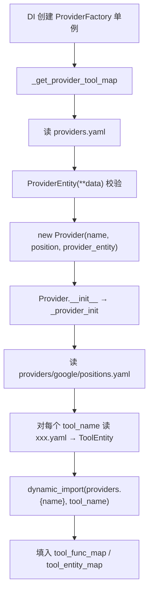
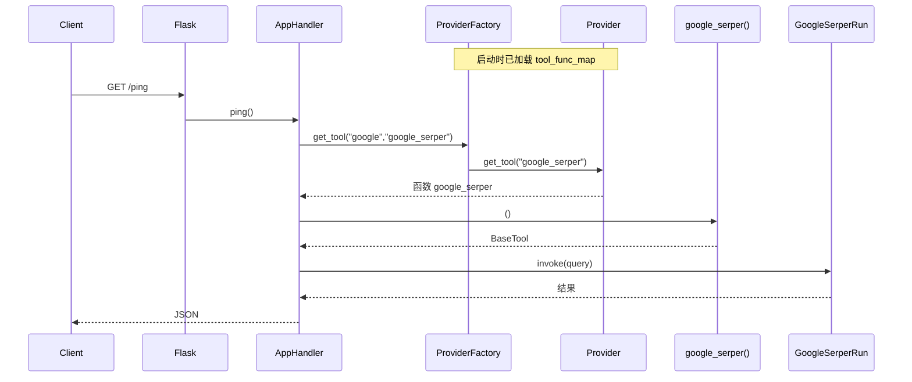

# 内置工具（`internal/core/tools`）架构说明

本文档汇总 builtin_tools 模块的设计、`ProviderFactory` / `Provider` 协作方式、从 HTTP 到 LangChain
工具的调用链，以及扩展新工具/新服务商的步骤。对应代码路径：`internal/core/tools/builtin_tools/`。

---

## 0. 完整目录树（对照查看）

以下路径均相对于仓库根目录 **`llmops-api/`**。在 IDE 中可按树形结构逐项打开，与下文章节对照。

```text
llmops-api/
├── docs/
│   └── builtin-tools-架构说明.md          # 本文档
│
├── app/http/
│   ├── app.py                               # Flask 启动；Injector 解析 Router / Handler
│   └── module.py                            # DI 模块（DB 等；ProviderFactory 靠 @singleton 自动绑定）
│
├── internal/
│   ├── lib/
│   │   └── helper.py                        # dynamic_import(module_name, symbol_name)
│   │
│   ├── router/
│   │   └── router.py                        # GET /ping → AppHandler.ping
│   │
│   ├── handler/
│   │   └── app_handler.py                   # 注入 ProviderFactory；ping 里 get_tool + invoke 示例
│   │
│   └── core/tools/                          # 工具域入口（当前仅 re-export 占位）
│       ├── __init__.py
│       └── builtin_tools/
│           ├── __init__.py
│           │
│           ├── entities/                    # 元数据模型 + Provider 运行时对象
│           │   ├── __init__.py              # 导出 ProviderEntity, Provider, ToolEntity
│           │   ├── provider_entity.py       # ProviderEntity、Provider、_provider_init
│           │   └── tool_entity.py           # ToolEntity（对应 *.yaml 字段）
│           │
│           └── providers/                   # 注册表 + 各服务商实现
│               ├── __init__.py              # 导出 ProviderFactory
│               ├── provider_factory.py      # 读 providers.yaml，构建 provider_map
│               ├── providers.yaml           # 全站服务商列表（→ ProviderEntity）
│               │
│               └── google/                  # name 须与 providers.yaml 中 name 一致
│                   ├── __init__.py          # 必须 export 各工具函数名（供 dynamic_import）
│                   ├── positions.yaml       # 工具名列表及加载顺序
│                   ├── google_serper.yaml   # 工具元数据（→ ToolEntity）
│                   ├── google_serper.py     # def google_serper() → BaseTool
│                   └── _asset/
│                       └── icon.svg         # providers.yaml 中 icon 字段引用
```

### 0.1 文件 ↔ 职责 ↔ 在流程中的位置

| 路径（相对 `llmops-api/`）                                                   | 职责                              | 何时被用到                                     |
|------------------------------------------------------------------------------|-----------------------------------|------------------------------------------------|
| `internal/core/tools/builtin_tools/providers/providers.yaml`                 | 定义有哪些 Provider               | 启动：`ProviderFactory._get_provider_tool_map` |
| `../internal/core/tools/builtin_tools/providers/builtin_provider_manager.py` | 单例工厂、`get_tool` 入口         | DI 注入 `AppHandler`；业务取工具               |
| `internal/core/tools/builtin_tools/entities/provider_entity.py`              | `Provider` 加载该目录下所有工具   | 每个 Provider 实例构造时 `_provider_init`      |
| `internal/core/tools/builtin_tools/providers/google/positions.yaml`          | 该 Provider 下工具顺序            | `_provider_init` 循环 tool_name                |
| `internal/core/tools/builtin_tools/providers/google/google_serper.yaml`      | 工具展示/参数元数据               | 填充 `tool_entity_map`                         |
| `internal/core/tools/builtin_tools/providers/google/google_serper.py`        | LangChain 工具工厂函数            | 填充 `tool_func_map`                           |
| `internal/core/tools/builtin_tools/providers/google/__init__.py`             | 把 `google_serper` 挂到包命名空间 | `dynamic_import(..., "google_serper")`         |
| `internal/lib/helper.py`                                                     | 动态 import                       | `_provider_init` 第 6 步                       |
| `internal/handler/app_handler.py`                                            | HTTP 调用示例                     | `GET /ping`                                    |
| `internal/router/router.py`                                                  | 路由绑定                          | 注册 `/ping`                                   |

### 0.2 新增文件应落在哪

| 你要做的事         | 新增/修改位置                                                                   |
|--------------------|---------------------------------------------------------------------------------|
| 新加一个 Provider  | `providers/providers.yaml` + 新建 `providers/{name}/` 整目录                    |
| 在 google 下加工具 | `providers/google/{tool}.yaml` + `{tool}.py` + `positions.yaml` + `__init__.py` |
| Provider 图标      | `providers/{name}/_asset/`（文件名与 yaml 里 `icon` 一致）                      |
| 业务里调用工具     | 一般只改 `internal/handler/` 或 `internal/service/`，不改工厂                   |

---

## 1. 模块在做什么？

`internal/core/tools` 当前主要是 **内置工具（builtin_tools）的注册与加载框架**：

- **YAML**：描述给前端/API/Agent 看的元数据（名称、描述、参数等）
- **Python**：提供真正可执行的 LangChain 工具（工厂函数 → `BaseTool` 实例）

核心类分工：

| 概念         | 类                | 数据来源                       | 作用                                |
|--------------|-------------------|--------------------------------|-------------------------------------|
| 服务商元数据 | `ProviderEntity`  | `providers/providers.yaml`     | name、label、icon、category 等      |
| 工具元数据   | `ToolEntity`      | `providers/{name}/{tool}.yaml` | 工具名、描述、params                |
| 可运行服务商 | `Provider`        | 工厂创建 + `_provider_init`    | `tool_entity_map` + `tool_func_map` |
| 全局入口     | `ProviderFactory` | 单例，启动时加载               | `provider_map`，对外 `get_tool` 等  |

目录约定（以 `google` 为例）：

```text
internal/core/tools/builtin_tools/
  entities/
    provider_entity.py   # ProviderEntity、Provider
    tool_entity.py       # ToolEntity
  providers/
    provider_factory.py
    providers.yaml       # 有哪些 provider
    google/
      positions.yaml     # 工具加载顺序（工具名列表）
      google_serper.yaml # 工具元数据
      google_serper.py   # 工具实现（函数名 = 工具名）
      __init__.py        # 必须 export 各 tool 函数（见下文）
```

---

## 2. 启动加载流程



### 2.1 `ProviderFactory`

- 装饰器：`@inject`、`@singleton`（全进程一个实例，首次注入时加载）
- `__init__` → `_get_provider_tool_map()`：
    1. 若 `provider_map` 非空则跳过（防重复加载）
    2. 读取同目录 `providers.yaml`
    3. 每条记录 → `ProviderEntity(**provider_data)`（Pydantic 校验）
    4. `provider_map[name] = Provider(name=..., position=idx+1, provider_entity=...)`
- **创建 `Provider` 时会执行 `_provider_init`**，因此每个服务商下的工具在 `Provider` 构造时加载，而非在工厂里单独写循环。

对外 API 简述：

- `get_provider(name)` → 单个 `Provider`
- `get_providers()` → 所有 `Provider`
- `get_provider_entities()` → 列表页用的 `ProviderEntity` 列表
- `get_tool(provider_name, tool_name)` → 见第 4 节

### 2.2 `Provider._provider_init`

1. 根据 `self.name` 定位 `providers/{self.name}/`
2. 读 `positions.yaml`，按顺序得到工具名列表
3. 对每个 `tool_name`：
    - 读 `{tool_name}.yaml` → `ToolEntity`
    - `dynamic_import("internal.core.tools.builtin_tools.providers.{self.name}", tool_name)` → 写入 `tool_func_map`

`dynamic_import`（`internal/lib/helper.py`）等价于：

```python
module = importlib.import_module(module_name)
return getattr(module, symbol_name)
```

因此工具函数必须出现在 **包模块的命名空间**上，通常通过在 `providers/google/__init__.py` 中
`from .google_serper import google_serper` 导出。

### 2.3 工具实现示例

`google_serper.py` 中的工厂函数返回 LangChain 工具实例：

```python
def google_serper(**kwargs) -> BaseTool:
    return GoogleSerperRun(...)
```

业务侧用法： **先 `get_tool` 拿到函数，再调用一次 `()` 得到 `BaseTool`**：

```python
google_serper = provider_factory.get_tool("google", "google_serper")()
google_serper.invoke("查询语句")
```

---

## 3. 从 `GET /ping` 到 `google_serper.invoke`

### 3.1 应用启动（工具只加载一次）

```text
python -m app.http.app
  → Injector → injector.get(Router)
       → AppHandler(provider_factory=ProviderFactory)
            → ProviderFactory.__init__ → _get_provider_tool_map()
                 → Provider("google", ...) → _provider_init()
```

路由注册：`internal/router/router.py` → `GET /ping` → `AppHandler.ping`。

### 3.2 单次请求

```text
GET /ping
  → AppHandler.ping()
       → provider_factory.get_tool("google", "google_serper")  # 返回 Python 函数
       → google_serper()                                        # 返回 GoogleSerperRun
       → .invoke("...")
       → success_json()
```

### 3.3 时序图



### 3.4 为何是 `get_tool(...)()` 两个括号？

| 步骤                                  | 得到什么                                               |
|---------------------------------------|--------------------------------------------------------|
| `get_tool("google", "google_serper")` | 注册表里的 **工厂函数**（可扩展 `**kwargs`）           |
| `()`                                  | 执行工厂，得到 **LangChain `BaseTool`**，才能 `invoke` |

YAML 管展示/schema；Python 管执行。

---

## 4. `ProviderFactory.get_tool` 不是「自己调自己」

工厂方法与 `Provider` 方法 **同名但属于不同类**，是委托关系，不是递归。

**工厂**（需要服务商名 + 工具名）：

```python
# builtin_provider_manager.py — ProviderFactory
def get_tool(self, provider_name: str, tool_name: str) -> Any:
    provider = self.get_provider(provider_name)  # self 是 ProviderFactory
    if provider:
        return provider.get_tool(tool_name)  # provider 是 Provider 实例
    return None
```

**Provider**（只需工具名，从本 provider 的 map 取）：

```python
# provider_entity.py — Provider
def get_tool(self, tool_name: str):
    return self.tool_func_map.get(tool_name)
```

记忆方式：Python 看 **点号左边的对象类型**。只有 `self.get_tool(...)` 且仍在 `ProviderFactory` 内、参数仍是
`(provider_name, tool_name)` 才是自调用；这里是 `provider.get_tool(tool_name)`，参数个数也不同（2 vs 1）。

---

## 5. 扩展指南

### 5.1 在现有 Provider（如 `google`）下新增工具

以 `google_translate` 为例：

| 步骤 | 操作                                                                                            |
|------|-------------------------------------------------------------------------------------------------|
| 1    | 新增 `providers/google/google_translate.yaml`（符合 `ToolEntity`）                              |
| 2    | 新增 `providers/google/google_translate.py`，定义 `def google_translate(**kwargs) -> BaseTool:` |
| 3    | 在 `positions.yaml` 增加 `- google_translate`                                                   |
| 4    | 在 `providers/google/__init__.py` 导出 `google_translate`（**dynamic_import 必需**）            |

使用：

```python
tool = provider_factory.get_tool("google", "google_translate")()
```

无需修改 `ProviderFactory` / `Provider` 类代码。

### 5.2 新增 Provider（如 `openai`）

| 步骤 | 操作                                                                             |
|------|----------------------------------------------------------------------------------|
| 1    | 在 `providers.yaml` 增加一项，`name` 与文件夹名一致                              |
| 2    | 新建 `providers/openai/`：`positions.yaml`、各工具的 `{tool}.yaml` + `{tool}.py` |
| 3    | `providers/openai/__init__.py` 导出所有 tool 函数                                |
| 4    | 可选：`_asset/icon.svg` 等资源                                                   |

`Provider._provider_init` 按 `self.name` 自动加载 `providers/{name}/`，工厂逻辑不用改。

### 5.3 本地自检

```bash
python -c "
from internal.core.tools.builtin_tools.providers import ProviderFactory
f = ProviderFactory()
p = f.get_provider('google')
print([t.name for t in p.get_tool_entities()])
fn = f.get_tool('google', 'google_serper')
print(fn, fn())
"
```

或启动服务后 `GET /ping`（`invoke` 需配置 Serper 等环境变量）。

### 5.4 与 Agent 集成（概念）

```python
tools = []
for prov in provider_factory.get_providers():
    for te in prov.get_tool_entities():
        tools.append(provider_factory.get_tool(prov.name, te.name)())
# tools 可用于 llm.bind_tools / LangGraph ToolNode
```

---

## 6. 实现细节与注意点

1. **类变量 `provider_map`**：当前配合单例使用；若改为多实例或热重载，更稳妥的是实例属性 `self.provider_map = {}`。
2. **Pydantic 可变默认值**：`tool_func_map` / `tool_entity_map` 默认 `{}`；若遇多 Provider 数据串扰，可改为
   `Field(default_factory=dict)`。
3. **与 study 示例的关系**：`study/` 中 LangGraph 示例手写 `GoogleSerperRun`；本模块将其 **配置化**，便于平台统一注册与 UI
   展示。

---

## 7. 相关文件索引

| 文件                                | 说明                                           |
|-------------------------------------|------------------------------------------------|
| `providers/provider_factory.py`     | 工厂与 `providers.yaml` 加载                   |
| `entities/provider_entity.py`       | `ProviderEntity`、`Provider`、`_provider_init` |
| `entities/tool_entity.py`           | `ToolEntity`                                   |
| `providers/google/google_serper.py` | 工具工厂函数示例                               |
| `internal/handler/app_handler.py`   | `ping` 中 `get_tool` 使用示例                  |
| `internal/router/router.py`         | `/ping` 路由                                   |
| `internal/lib/helper.py`            | `dynamic_import`                               |
